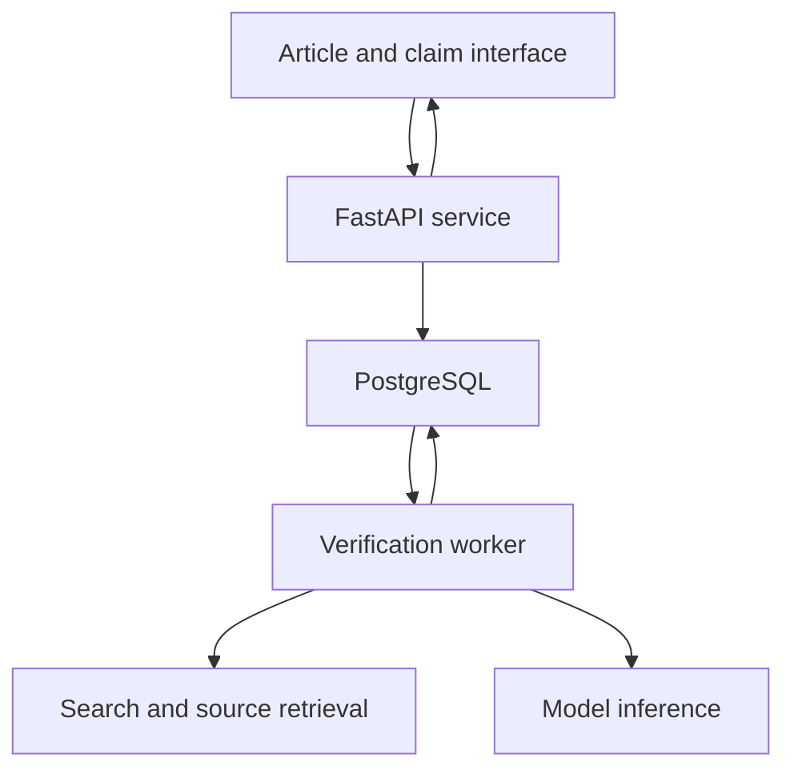

# FactThread Design Document

Version 0.1 | November 15, 2026 | First draft for implementation

## 1 Purpose and proposal

FactThread is a personal engineering project that helps readers examine factual claims in AI news and technical articles. It extracts checkable claims, retrieves external evidence, and presents source-linked assessments that a reader can inspect and correct.

The proposed first release verifies a single claim. The next release analyzes up to five selected claims from a pasted article. Each assessment must preserve the original statement, identify the evidence actually retrieved, explain what that evidence establishes, and expose uncertainty. A verdict is an assessment relative to available evidence and a stated time, rather than a guarantee of truth.

This document defines the proposed product, technical architecture, data contracts, verification rules, evaluation plan, and implementation milestones. All performance targets below are provisional engineering goals; no results have been measured yet.

## 2 Users and scope

The initial user is a student, developer, or technical reader evaluating statements about AI capabilities, benchmarks, pricing, and adoption. A typical user pastes a statement such as "Model X outperforms humans on every reasoning task" and wants to understand the scope and quality of the supporting evidence.

### Release scope

| Stage | Included | Completion evidence |
|---|---|---|
| Single claim prototype | Claim input, optional claim date, retrieval, evidence passages, verdict, explanation | Reproducible verification runs and an initial labeled evaluation |
| Article MVP | Pasted English text, atomic claim extraction, up to five selected claims, highlighting, review, persisted history | A user can complete and revisit an article review |
| Later extensions | Public URL import, account-based history, retrieval experiments, calibrated confidence | Separately evaluated additions |

The MVP excludes images and video, paywall bypass, multilingual verification, autonomous publication, browser extensions, and a single numerical truth score for an article. Future predictions and subjective opinions are identified but not assigned factual verdicts. No custom model training is required initially.

Pasted text is the initial article input. Public URL import is deferred because fetching arbitrary pages introduces extraction, availability, and security concerns beyond the core verification experiment.

## 3 User experience

The single-claim page has an input field, optional date, and a Verify button. During processing, the user sees stages such as searching, reading sources, and assessing evidence. The result contains the original claim, verdict, explanation, exact supporting or conflicting passages, source links, source dates when known, and unresolved questions.

The article page has two panels. The left panel displays the original text and highlights selected factual spans. The right panel displays the selected claim and its evidence. Status is communicated with text and icons as well as color. Opinions and unverified factual statements remain distinguishable from verified claims.

A review action lets a user retain or change a verdict and record a reason. Human edits never overwrite the original model output. A corrected result is visibly marked as reviewed. History belongs to a private owner session initially; cross-device accounts can be added later.

## 4 Verdict semantics

| Verdict | Meaning |
|---|---|
| Supported | Retrieved evidence adequately supports all material parts of the atomic claim under matching conditions |
| Refuted | Retrieved evidence directly conflicts with a material part of the claim |
| Insufficient evidence | Available evidence does not establish support or refutation |
| Conflicting evidence | Relevant sources materially disagree and the conflict remains unresolved |

"Partially supported" is an article-level presentation summary when subclaims receive different outcomes. It is not a shortcut for skipping claim decomposition. Opinion, prediction, and needs-context are claim categories, separate from verdicts.

A failed fetch or exhausted budget is an operational condition, not a factual refutation. Store it separately and show the result as incomplete. Insufficient evidence must describe the search limits; it does not establish that no evidence exists anywhere.

AVeriTeC combines conflicting evidence and cherry-picking in one label. FactThread preserves original dataset labels in evaluation records and documents any mapping. Its product labels must not be presented as an exact reproduction of that benchmark taxonomy.

## 5 Architecture and technology choices

Use a Next.js and TypeScript frontend, a Python FastAPI backend, and PostgreSQL for durable application state. Python supports retrieval and evaluation experiments; the frontend supports interactive document review. This split is a proposed choice, not a prerequisite for claim verification.

Deploy the frontend and backend as ordinary services. Use one Python worker process for long-running verification. In the prototype, PostgreSQL stores jobs and the worker claims queued rows transactionally. This avoids adding Redis before it is needed. Jobs have leases, heartbeats, bounded retries, and idempotent writes. A later queue migration can retain the same job contract.



The backend owns provider credentials. Provider adapters isolate search, fetching, and model calls. The model receives retrieved evidence as untrusted data and produces schema-validated output. It does not choose arbitrary executable tools or database operations.

## 6 Verification pipeline

### 6.1 Preserve and extract

Save immutable original text and its hash. Extract atomic claims with a structured-output LLM. Each claim records the verbatim source span, normalized standalone statement, category, and relevant entities, dates, quantities, comparisons, and qualifiers.

Calculate offsets in code by matching quoted spans against the original text. Repeated spans require contextual disambiguation. Reject ambiguous matches rather than highlighting an unrelated sentence. Preserve a mapping if text is normalized. A claim must retain scope words such as "some," "all," "may," and "as of 2024."

For the article MVP, let users select up to five claims. Initial ordering can favor factual specificity and prominence, but must not silently imply that unselected claims were checked.

### 6.2 Generate verification questions

For each claim, generate a small set of neutral questions identifying missing information and possible counterevidence. A cost-reduction claim should trigger questions about the comparison baseline, date, units, workload, and pricing category. Query generation must not assume the claim is true.

Initially allow up to three search queries per claim. This is a configurable budget, not a research-established optimum.

### 6.3 Retrieve and preserve sources

Use a search API to discover candidates, then fetch and extract permitted public page text. Search snippets are candidate discovery aids; the default final assessment uses fetched content. If a source cannot be read, disclose that limitation and do not invent its contents.

Store URL, canonical URL, title, publisher, author when available, publication date when available, retrieval timestamp, extraction status, content hash, and the text used for inference. Limit private snapshot retention and avoid publicly redistributing full source pages. Deduplicate identical content and group obvious syndicated copies so repeated publication is not counted as independent confirmation.

Start with up to ten candidate pages per claim, a configurable per-page size cap, fetch timeouts, and an overall run budget. Prefer original reports, papers, documentation, and direct records appropriate to the claim. An official source can establish what an organization announced without independently proving that announcement's performance claims.

### 6.4 Select evidence passages

Split fetched documents into paragraph-based chunks with source offsets. The first baseline uses BM25 over the candidate chunks. Evaluate dense retrieval and reciprocal rank fusion as subsequent variants. A cross-encoder reranker can then score claim-passage relevance. Relevance scores are never treated as truth probabilities.

Select a bounded evidence packet, initially up to six passages, while retaining necessary surrounding context. Seek direct support and counterevidence. One decisive primary source can be sufficient; numerous copied or indirect sources can still be insufficient.

### 6.5 Assess evidence

Use an LLM with a strict schema to assess entailment, contradiction, or neutrality between passages and the claim, then synthesize a verdict across the packet. A dedicated NLI model is an optional comparison baseline. NLI checks textual relationships, not the underlying truth or independence of a source.

Check entity, temporal, numerical, unit, benchmark, and scope consistency explicitly. Evidence about one benchmark cannot establish superiority on all tasks. Absence of supporting evidence alone does not establish refutation. Material unresolved source disagreement should remain visible.

### 6.6 Validate output

Code validates that every cited ID exists in the current run, each quoted passage matches stored extracted text, and every evidence item resolves to a fetched source. A separate model-based audit checks whether explanation sentences are supported, but this audit is itself evaluated against human judgments.

Invalid references trigger one repair attempt. Persist an incomplete or needs-review result when validation still fails. Do not silently strip invalid citations and keep a strong verdict. Preserve the original response and validation failures for debugging without exposing credentials or private content in logs.

## 7 Data model and contracts

| Entity | Important fields |
|---|---|
| Article | id, owner_session_id, original_text, text_hash, created_at |
| Claim | id, article_id nullable, source_span, start_offset, end_offset, normalized_text, category, claim_date nullable |
| Verification run | id, claim_id, status, evidence_as_of, model_version, prompt_version, retrieval_config, started_at, completed_at, cost, error_code |
| Source snapshot | id, canonical_url, retrieved_at, published_at nullable, content_hash, extraction_status, stored_text_reference |
| Evidence | id, run_id, source_snapshot_id, exact_quote, source_offsets, relation, selection_rank |
| Assessment | run_id, verdict, explanation, explanation_citations, unresolved_questions, needs_review, validation_status |
| Review | id, run_id, reviewer_session_id, revised_verdict, reason, created_at |
| Job | id, run_id, state, attempt, lease_until, progress, error_code |

Runs are immutable once completed. A new verification creates a new run, allowing time-sensitive results and changes in models or evidence to be compared. Reviews append to a run rather than mutating the assessment. Source and evidence records have referential constraints; application validation checks offset bounds and text matches.

Example response contract below is illustrative, not a real verification result:

```json
{
  "run_id": "run_example",
  "status": "completed",
  "claim": "Model X outperforms humans on all reasoning tasks.",
  "verdict": "insufficient_evidence",
  "explanation": "The retrieved study covers one benchmark and does not establish performance across all reasoning tasks.",
  "explanation_citations": ["ev_example"],
  "evidence": [{
    "id": "ev_example",
    "source_id": "src_example",
    "quote": "Exact passage from a retrieved source",
    "relation": "neutral"
  }],
  "unresolved_questions": ["Which other reasoning tasks were evaluated?"],
  "needs_review": true,
  "validation_status": "passed"
}
```

Source URLs and titles are joined from backend records, never accepted as newly invented model references. Evidence-level relation describes the whole atomic claim; a neutral passage can still explain a narrower supported subclaim.

## 8 API and job lifecycle

| Endpoint | Purpose |
|---|---|
| POST /v1/claims/verify | Validate claim input and create a verification job; return HTTP 202 and job ID |
| POST /v1/articles | Save pasted text and create an extraction job |
| GET /v1/articles/{id} | Return original text, extracted claims, and run summaries |
| POST /v1/articles/{id}/verify | Verify explicitly selected claim IDs |
| GET /v1/jobs/{id} | Return progress and structured operational errors |
| GET /v1/runs/{id} | Return assessment and evidence |
| POST /v1/runs/{id}/reviews | Append a human correction |
| DELETE /v1/articles/{id} | Delete owner content and linked records according to retention rules |

Job states are queued, running, completed, partial, failed, and cancelled. The frontend initially polls with backoff. Each claim can finish independently; one failed claim does not erase the other results. Idempotency keys prevent duplicate submissions from creating duplicate provider work. Retry transient timeouts and rate limits with bounded exponential backoff; do not retry invalid input indefinitely.

## 9 Evaluation plan

### Data and leakage controls

Inspect twenty AVeriTeC cases as learning and development examples. Keep them out of the final held-out test. Begin with a versioned pilot set of roughly one hundred claims; sample across available labels and report the actual distribution. Add a small separately annotated set of AI-specific claims because general fact-checking performance does not establish AI-domain performance.

Separate development and test data by article and near-duplicate claim groups. Keep labels, human justifications, and gold QA answers outside the system input in end-to-end tests. In live retrieval evaluations, identify and exclude direct fact-check articles or answer-bearing copies when measuring independent evidence discovery; separately report a setting that allows prior fact-check lookup. Record source dates and retrieval dates to make temporal leakage visible.

Evaluate two tasks separately: evidence-given assessment using human evidence, and end-to-end assessment using system-retrieved evidence. The first diagnoses reasoning; the second includes retrieval failures. Claim extraction requires its own article-level annotations because an isolated-claim benchmark does not evaluate extraction.

### Metrics

| Metric | Definition and use |
|---|---|
| Extraction precision and recall | Correctly extracted checkable claims versus predicted and annotated claims, using documented human matching rules |
| Evidence Recall at k | Fraction of annotated relevant evidence items retrieved within the first k results; report evidence-granularity rules |
| Verdict macro F1 | Mean class F1 across the declared labels, plus confusion matrix and per-class support |
| Citation precision | Fraction of assessed citation links that support the statement they are attached to |
| Explanation evidence coverage | Fraction of checkable explanation statements adequately backed by cited evidence |
| Joint success | Fraction of claims with both correct verdict and sufficient relevant evidence under a documented human rubric |
| Coverage and selective error | Fraction receiving a decisive verdict and error among those decisions; also report all-label performance |
| Operational performance | Median and p95 latency, cost per run, fetch failures, incomplete runs, and validation failures |

Use official benchmark scripts only with their expected schema, label mapping, and pinned version. Call the custom joint metric FactThread joint success rather than FEVER score or AVeriTeC score. Gold evidence is not exhaustive on the open web; human review can recognize alternative sufficient evidence.

Do not display uncalibrated model-generated percentages as confidence. Initially show verdict, evidence, limitations, and review status. If confidence is introduced later, fit calibration on development data and evaluate reliability on a separate test set. Automated citation or NLI scores remain proxies subject to human audit.

### Experiments and acceptance criteria

Compare A: model without retrieval; B: search plus fetched text; C: B plus passage retrieval and reranking; D: C plus validation and abstention rules. Hold the input set and budgets consistent, log differences, and measure cost as well as quality. Use paired error analysis; report sample counts and uncertainty rather than claiming a small difference is conclusive.

Provisional MVP gates are: every displayed citation resolves to a fetched snapshot and matching quote; no known invalid citation is silently published; missing or conflicting evidence remains visible; original model results survive human edits; the held-out evaluation and failure examples are reproducible. Numerical quality, latency, and cost thresholds will be set after the pilot baseline, before the final comparison.

Regression cases include changed numbers, dates, units, entity names, negation, "some" versus "all," stale pages, syndicated duplicates, dead links, and prompt injection embedded in sources. Unit tests cover deterministic validation and job transitions; integration tests use fixed search and page fixtures; end-to-end tests cover one successful and one partial article review.

## 10 Security and operational limits

Treat article and source text as untrusted input. Separate it from system instructions, restrict model output to schemas, and never execute commands from retrieved content. Render extracted text as escaped content rather than arbitrary source HTML.

Even evidence URLs discovered through search require URL validation. Allow HTTP and HTTPS only, block private and loopback destinations, revalidate redirects and resolved addresses, cap response size and time, and restrict supported content types. Rate-limit submissions, cap article length and claim count, and enforce per-run token and search budgets.

Protect session ownership on every history and review endpoint. Keep API keys server-side. Redact user text from routine logs, record stage-level metadata instead, and provide content deletion. Before a public demo, configure explicit retention and concurrency limits. Honor source access restrictions and dataset licenses; AVeriTeC's repository states a noncommercial attribution license, which requires review before commercial reuse.

## 11 Implementation milestones

| Milestone | Work | Exit condition |
|---|---|---|
| 1 Understand data | Inspect twenty AVeriTeC examples, document labels, write input and output schemas | Can explain claim to questions to evidence to verdict using real examples |
| 2 Verify given evidence | Implement schema-constrained assessment and reference validation | Pilot evaluation isolates assessment errors |
| 3 Retrieve evidence | Add search, fetching, snapshots, chunking, and baseline ranking | Single-claim run works with actual retrieved evidence |
| 4 Evaluate variants | Add test splits, metrics, regression cases, and retrieval comparisons | Reproducible report includes failures, cost, and latency |
| 5 Build article MVP | Add extraction, highlighting, jobs, review, and private history | Complete article workflow passes integration checks |
| 6 Deploy and document | Configure service limits, retention, README, architecture, demo | Public demo is usable within a controlled budget |

These are ordered milestones rather than a promised schedule. A four-week first pass is an optional planning target; retrieval and evaluation quality determine whether scope needs adjustment.

## 12 Decisions still open

Choose the model and search provider through a small quality, cost, and access comparison. Determine hosting and spending limits before deployment. Decide whether a public demo needs durable accounts or whether private session history is sufficient. Set source snapshot retention and an approach to archived or unavailable evidence. Confirm the label mapping and citation evaluation rubric before running comparisons.

The next concrete task is to create a small development sample and implement evidence-given verification with strict evidence IDs. This produces a testable core before search and article extraction add additional failure modes.

## 13 References

1. Schlichtkrull et al. AVeriTeC: A Dataset for Real-world Claim Verification with Evidence from the Web. NeurIPS 2023. https://papers.neurips.cc/paper_files/paper/2023/hash/cd86a30526cd1aff61d6f89f107634e4-Abstract-Datasets_and_Benchmarks.html
2. AVeriTeC official data and baseline repository. Dataset schema, evaluation entry point, baseline stages, and license. https://github.com/MichSchli/AVeriTeC
3. AIC CTU system at AVeriTeC: Re-framing automated fact-checking as a simple RAG task. 2024. https://arxiv.org/abs/2410.11446
4. Thorne et al. FEVER: A Large-scale Dataset for Fact Extraction and VERification. NAACL 2018. https://aclanthology.org/N18-1074/
5. Gao et al. Enabling Large Language Models to Generate Text with Citations. EMNLP 2023. https://aclanthology.org/2023.emnlp-main.398/ and https://github.com/princeton-nlp/ALCE
6. Thakur et al. BEIR: A Heterogeneous Benchmark for Zero-shot Evaluation of Information Retrieval Models. NeurIPS 2021. https://datasets-benchmarks-proceedings.neurips.cc/paper_files/paper/2021/hash/65b9eea6e1cc6bb9f0cd2a47751a186f-Abstract-round2.html

Research references inform the design. Component budgets, release scope, schema, and acceptance criteria in this draft are proposed FactThread engineering choices, not reported findings from those papers.
